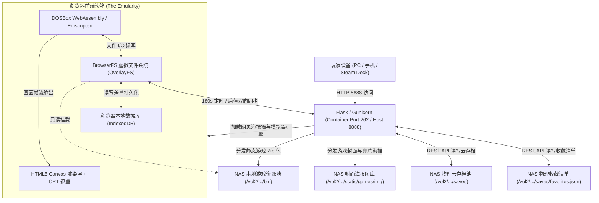
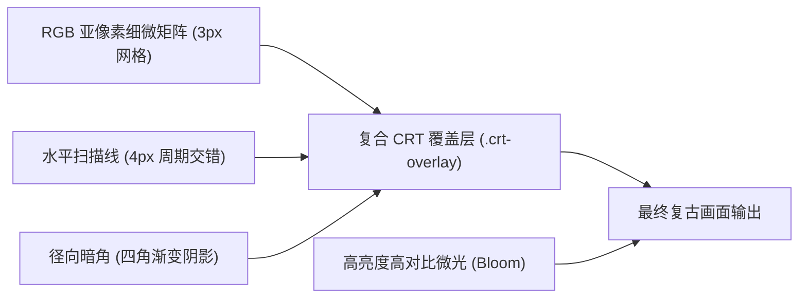
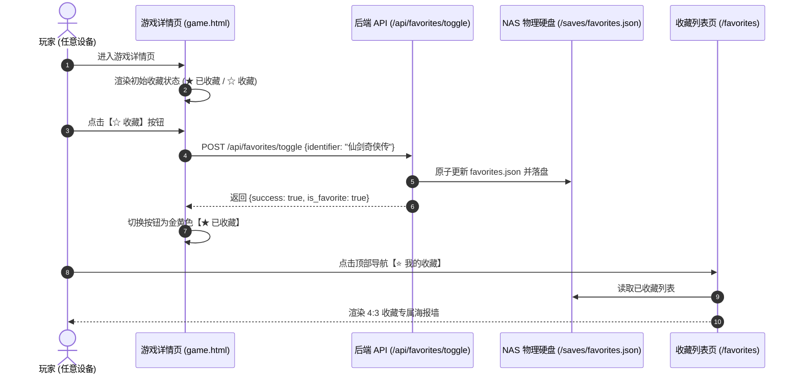
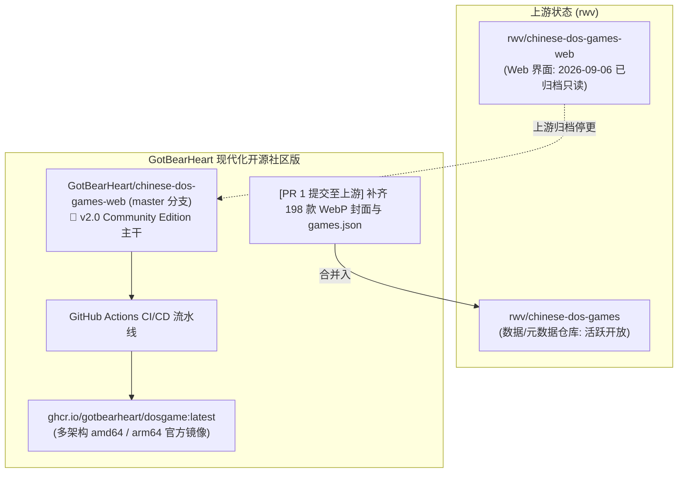

# 飞牛 OS (fnOS) DOS 游戏容器 (dosgame) 迁移、架构、CRT 滤镜、云存档、海报墙、收藏系统与 Community Edition 实战指南

> **文档信息**  
> - **宿主机环境**：飞牛私有云 OS (fnOS / Linux fsMoonstone)  
> - **服务地址**：`http://192.168.0.66:8888/`  
> - **容器镜像**：`ozbillwang/dosgame:latest` → 升级推荐 `ghcr.io/gotbearheart/dosgame:latest`  
> - **游戏资产路径**：`/vol2/1000/Games/dos-games-master/` (1,898 款 DOS 游戏，约 37GB)  
> - **云存档物理路径**：`/vol2/1000/Games/dos-games-master/saves/<游戏ID>/`  
> - **物理收藏配置**：`/vol2/1000/Games/dos-games-master/saves/favorites.json`  
> - **封面海报路径**：`/vol2/1000/Games/dos-games-master/static/games/img/<游戏ID>/` (1,498 张实体封面 + 1 张复古兜底 SVG)  
> - **社区维护版仓库**：[`GotBearHeart/chinese-dos-games-web`](https://github.com/GotBearHeart/chinese-dos-games-web) (Community Edition)  
> - **数据资产仓库**：[`GotBearHeart/chinese-dos-games`](https://github.com/GotBearHeart/chinese-dos-games) (已提交 PR 至 `rwv/chinese-dos-games`)

---

## 目录
1. [背景与目标](#一背景与目标)
2. [底层架构与运行机制解析](#二底层架构与运行机制解析)
3. [容器迁移与旧卷清理实录](#三容器迁移与旧卷清理实录)
4. [在线版本与 Git 关联查证](#四在线版本与-git-关联查证)
5. [CRT 复古滤镜与全屏架构改造](#五crt-复古滤镜与全屏架构改造)
6. [跨设备云存档全自动同步架构 (重点)](#六跨设备云存档全自动同步架构-重点)
7. [封面海报全自动补全与海报墙 WebUI 改造](#七封面海报全自动补全与海报墙-webui-改造)
8. [跨设备游戏收藏 (Favorites) 系统架构](#八跨设备游戏收藏-favorites-系统架构)
9. [开源贡献、上游归档与 Community Edition 演进](#九开源贡献上游归档与-community-edition-演进)
10. [排错记录与故障复盘](#十排错记录与故障复盘)
11. [日常运维与操作备忘](#十一日常运维与操作备忘)

---

## 一、 背景与目标

### 1. 现状问题
- 用户在 NAS 存储池重整时，将原本存放在系统盘的数据转移到了大容量存储池中，完整目录存放于 `Games/dos-games-master`（宿主机绝对路径：`/vol2/1000/Games/dos-games-master`）。
- 既有的 Docker 容器 `dosgame` 处于停止状态（`Exited (0)`），因其内部绑定的数据卷指向旧存储路径，导致容器无法关联到移动后的游戏目录。
- 旧 Docker 卷依然保存在系统盘 `/vol1/docker/volumes/dosgame`，无端占用了 SSD 系统盘约 37GB 空间。
- 游戏原始运行逻辑仅支持在浏览器客户端本地（IndexedDB）存储存档，换电脑、平板或手机无法读取游戏进度。
- 原始游戏列表（`/games/`）与搜索页（`/search`）仅采用简陋的纯文本无序列表（`<ul><li>`），近 1,900 款游戏缺乏海报直观展示。
- 缺乏游戏收藏管理体系，用户无法将喜爱的游戏加入个人偏好清单，每次找游戏需在近 2000 款中重新翻查。
- 原上游 Web 前端仓库 `rwv/chinese-dos-games-web` 于 2026 年 9 月被作者归档（Archived），外部 PR 通道关闭，亟需建立长期活跃维护的社区版。

### 2. 达成目标
1. 重新配置并启动 `dosgame` 容器，精确挂载 `/vol2` 新路径中的 1,898 个游戏压缩包与元数据。
2. 安全移除系统盘 `/vol1` 上的旧冗余 Docker Volume，释放 37GB SSD 空间。
3. 深入分析上游镜像版本、Git 状态、游戏存档机制与输入操控原理。
4. 为 Web 端游戏画面引入兼顾高保真质感与零性能开销的 **CRT 扫描线与暗角滤镜**，并修复全屏模式下的滤镜协同与按键控制。
5. 构建 **基于 NAS 的全自动云存档同步引擎**，支持启动时自动拉取、**180 秒智能定时增量上传**、切页/关闭页面即时保存与多端漫游。
6. 全量补齐 1,898 款游戏的封面图片（从 `dos.lol` 自动拉取缺失海报 + 专属复古 SVG 兜底），重构游戏列表与搜索页为**现代化响应式 4:3 海报墙卡片**，集成原生懒加载与毫秒级即时筛选。
7. 构筑**跨设备游戏收藏（Favorites）系统**：游戏详情页支持一键切换收藏状态并即时高亮，全局导航栏配备【⭐ 我的收藏】直达入口，提供专属海报列表页与空状态友好指引，数据落盘 NAS 物理存储实现全端永久同步。
8. 向上游活跃数据仓库提交 **PR 1**，并将全套 Web 改进融合入 [`GotBearHeart/chinese-dos-games-web`](https://github.com/GotBearHeart/chinese-dos-games-web) 主干，构建**现代化多架构 Docker 镜像与 CI/CD 流水线**。

---

## 二、 底层架构与运行机制解析

`ozbillwang/dosgame` 是基于 Python Flask + Gunicorn + The Emularity（DOSBox Emscripten）构建的前后端一体化 Web DOS 游戏运行环境。



### 1. 游戏原始存储机制
* **只读基础层（Read-Only Base）**：
  游戏启动时，前端通过 `fetchFile` 下载对应的游戏 Zip 包（如 `仙剑奇侠传.zip`），由 `BFSOpenZip` 挂载为只读文件系统至虚拟 DOS 的 `C:` 盘（`/c`）。
* **可写差量层（OverlayFS + AsyncMirrorFS）**：
  模拟器使用 BrowserFS 构建 `OverlayFS`，上层覆盖一个 `deltaFS`。
  - **内存镜像（inMemoryFS）**：为 DOSBox C++ 运行时提供纯同步的文件读写；
  - **本地存储持久化（IndexedDB）**：文件写入（如游戏存档 `SAVE0.DAT`）会被异步镜像到当前浏览器的 **IndexedDB** 本地数据库中。

### 2. 操控与输入处理
* **键盘**：Canvas 监听 DOM `keydown`/`keyup` 事件，通过 Emscripten 实时转换为标准 IBM PC AT 硬件扫描码。`loader.js` 内置 `blockSomeKeys()` 自动屏蔽方向键及翻页键的浏览器原生滚动行为。
* **鼠标与全屏光标**：绑定 `canvas.requestPointerLock()`，支持第一人称或策略类 DOS 游戏的连续鼠标相对移动。
* **手柄**：自动捕获 HTML5 Gamepad API，映射为标准 DOS 2轴4键游戏杆。

---

## 三、 容器迁移与旧卷清理实录

### 1. 挂载点重新规划与启动
为保证对前端海报、样式表、模板及后端 API 的改动无需重新打包镜像，本次部署将宿主机核心路径全面映射至容器内部：

```bash
docker run -d \
  --name dosgame \
  --restart unless-stopped \
  -p 8888:262 \
  -e SUBFOLDER=/dosgame/ \
  -e TITLE=DosGame \
  --device /dev/fuse \
  -v /vol2/1000/Games/dos-games-master/bin:/app/static/games/bin:rw \
  -v /vol2/1000/Games/dos-games-master/templates:/app/templates:ro \
  -v /vol2/1000/Games/dos-games-master/static/css:/app/static/css:ro \
  -v /vol2/1000/Games/dos-games-master/static/js:/app/static/js:ro \
  -v /vol2/1000/Games/dos-games-master/static/emularity:/app/static/emularity:ro \
  -v /vol2/1000/Games/dos-games-master/app.py:/app/app.py:ro \
  -v /vol2/1000/Games/dos-games-master/saves:/app/saves:rw \
  -v /vol2/1000/Games/dos-games-master/static/games/img:/app/static/games/img:ro \
  -v /vol2/1000/Games/dos-games-master/static/games/games.json:/app/static/games/games.json:ro \
  -v /vol2/1000/Games/dos-games-master/games.json:/app/games.json:ro \
  ozbillwang/dosgame
```

| 参数 / 挂载源 | 容器目标路径 | 作用与权限 |
| :--- | :--- | :--- |
| `-p 8888:262` | 容器 `262` 端口 | 对外提供 Web 服务端口 `8888` |
| `--restart unless-stopped` | 进程守护 | 随 NAS 开机自启 |
| `.../bin` | `/app/static/games/bin` | 1898 个游戏 ZIP 文件存储源 (RW) |
| `.../templates` | `/app/templates` | 网页 HTML 模板热加载 (RO) |
| `.../static/css` | `/app/static/css` | CRT 样式表与海报墙 CSS 热加载 (RO) |
| `.../static/js` | `/app/static/js` | 控制与云同步逻辑脚本热加载 (RO) |
| `.../static/emularity` | `/app/static/emularity` | 模拟器加载引擎热加载 (RO) |
| `.../app.py` | `/app/app.py` | Flask Web 路由及云存档/收藏 REST API (RO) |
| `.../saves` | `/app/saves` | **NAS 物理云存档与收藏持久化目录 (RW)** |
| `.../static/games/img` | `/app/static/games/img` | **全量封面海报与兜底 SVG 存储源 (RO)** |
| `.../static/games/games.json` | `/app/static/games/games.json` | **元数据索引（含海报关联）(RO)** |

### 2. 旧卷清理
新容器正常提供服务后，针对旧 Volume 进行了安全移除：
```bash
docker volume rm dosgame
```
释放了系统盘 `/vol1/docker/volumes/dosgame` 下冗余占用的 **37 GB** 存储空间。

---

## 四、 在线版本与 Git 关联查证

### 1. Docker Hub 镜像版本比对
* 通过 Docker Hub Registry API 检索：远程仅有唯一标签 `latest`，镜像最终推送时间为 **2023-08-31**，NAS 本地镜像 Digest 经校验完全一致。
* **结论**：官方目前**没有任何更新的镜像版本**，当前运行的已是最终发布版。

### 2. Git 关联状态
* 目录未包含 `.git` 文件夹，为 GitHub 解压所得代码。保持普通文件夹状态，避免因 Git 追踪 37GB 二进制大包产生性能灾难。

---

## 五、 CRT 复古滤镜与全屏架构改造

为还原 90 年代老式大头电脑 CRT 显示器的经典质感，同时避免 WebGL 着色器带来的移动端发热与掉帧，采用**纯 CSS 复合渲染技术**开发了高精度 CRT 滤镜。



### 1. CSS 核心样式 (`static/css/main.css`)
```css
/* 容器相对定位与黑底居中 */
#screen_container {
    position: relative;
    background-color: #000;
    overflow: hidden;
    width: 100%;
    display: flex;
    justify-content: center;
    align-items: center;
}

/* CRT 覆盖层：扫描线 + 暗角 + RGB 网格 */
.crt-overlay {
    display: none;
    position: absolute;
    top: 0; left: 0; width: 100%; height: 100%;
    pointer-events: none !important;
    z-index: 10;
}

.crt-overlay.crt-active {
    display: block;
    background: 
        radial-gradient(ellipse at center, transparent 65%, rgba(0, 0, 0, 0.35) 85%, rgba(0, 0, 0, 0.8) 100%),
        linear-gradient(rgba(18, 16, 16, 0) 50%, rgba(0, 0, 0, 0.30) 50%),
        linear-gradient(90deg, rgba(255, 0, 0, 0.03), rgba(0, 255, 0, 0.01), rgba(0, 0, 255, 0.03));
    background-size: 100% 100%, 100% 4px, 3px 100%;
}

/* 显像管发光质感模拟 */
canvas.emscripten.crt-bloom {
    filter: contrast(1.08) brightness(1.1) saturate(1.15);
}

/* 原生全屏规范适配（4:3 等比居中） */
#screen_container:fullscreen {
    position: fixed !important;
    width: 100vw !important; height: 100vh !important;
    background-color: #000 !important;
    display: flex !important; justify-content: center !important; align-items: center !important;
    z-index: 99999 !important;
}
#screen_container:fullscreen canvas.emscripten {
    width: auto !important; height: 100vh !important;
    aspect-ratio: 4 / 3; object-fit: contain;
}
#screen_container:fullscreen .crt-overlay {
    width: 100% !important; height: 100% !important;
    z-index: 100000 !important;
}
```

---

## 六、 跨设备云存档全自动同步架构 (重点)

通过连接 BrowserFS 差量层与 NAS 服务端物理存储，彻底摆脱了单机 IndexedDB 的设备隔离限制。

### 1. 服务端 REST API (`app.py`)
在 Flask 中开辟无依赖、高性能的存取接口：
* **`GET /api/saves/<game_id>`**：扫描 `/app/saves/<game_id>/` 目录，将所有已落盘文件（如 `SAVE0.DAT`、`PAL.CFG`）转为 Base64 字典返回；若无存档则返回 `{"exists": false}`。
* **`POST /api/saves/<game_id>`**：接收客户端上传的 Base64 文件字典，安全净化路径（防目录遍历）后以原生二进制形式落盘至宿主机 `/vol2/1000/Games/dos-games-master/saves/<game_id>/`。

### 2. 前端初始化拉取 (`static/emularity/loader.js`)
在 `deltaFS` 初始化完成后、DOSBox 核心挂载运行前：
```javascript
if (game_data.fileSystemKey) {
  promises.push(
    window.fetch('/api/saves/' + encodeURIComponent(game_data.fileSystemKey))
      .then(function(res) { if (res.ok) return res.json(); return null; })
      .then(function(data) {
        if (data && data.success && data.files) {
          for (var sp in data.files) {
            deltaFS.writeFileSync(sp, new Buffer(base64ToBytes(data.files[sp])));
          }
        }
      })
  );
}
```

### 3. 智能多触发上传引擎 (`static/js/game.js` & `static/emularity/loader.js`)
* **底层写入即时感知 (Debounced FS Hook)**：在 `deltaFS.writeFileSync` 与 `unlinkSync` 植入拦截钩子。当玩家在游戏内点击存盘，系统在 1.5 秒防抖延迟后立即触发无体积限制的常规 `fetch` 上传，秒级落盘 NAS，彻底避免退出时因进程被杀或配额超限导致丢档。
* **15 秒高速轻量巡检**：以 15 秒为周期快速比对当前 `deltaFS` 文件哈希指纹（CPU 开销 <0.1ms），发现增量变动时静默增量同步。
* **W3C 64KB 配额防护与退避保底**：针对大体积存档（如《仙剑奇侠传》双存档达 180KB），规避浏览器 `sendBeacon` / `keepalive` 超过 64KB 会被静默丢弃的内核限制，对超出配额的大包安全降级为标准请求。
* **一键手动同步**：界面保留【☁️ 云存档: 就绪】操作按钮，支持玩家随时手动强制上传。

### 4. 零白名单全格式兼容与 COW 架构机制
许多玩家可能会疑虑：“近 2000 款 DOS 游戏的存档格式五花八门，系统怎么知道哪个文件是存盘？”  
答案是：**本架构基于文件系统层（VFS）的“写时复制（COW）”差量捕获，完全无需对任何文件后缀名进行预判或硬编码白名单。**

```mermaid
graph TD
    GameZip["原始游戏压缩包 (RO Mount)<br/>只读挂载于 MountableFileSystem"]
    DeltaFS["可写差量层 (deltaFS / IndexedDB)<br/>仅接管游戏运行期新产生或修改的文件"]
    
    DOSBox["DOSBox 模拟器进程 (Emscripten)"]
    
    DOSBox -->|只读读取原始资源| GameZip
    DOSBox -->|写入任何存盘/配置变动| DeltaFS
    
    DeltaFS -->|全盘递归扫描 walk('/')| CloudSave["☁️ 云存档引擎<br/>(无视后缀，自动上传所有 Delta 文件)"]
```

#### 通用兼容特性：
1. **零后缀预设，无差别捕获**：
   `loader.js` 的拦截钩子与 `game.js` 的 `collectDeltaFiles` 扫描不设任何正则匹配。不管游戏生成的存档叫 `1.RPG`、`SAVEDATA.DAT`、`GAME.SAV`、`REC.001`，还是纯无后缀文件，都会被百分之百抓取。
2. **只读层天然阻隔原始资源**：
   原始游戏包被挂载为只读，`deltaFS` 初始为空白，只有被游戏创建或修改的文件才会存在于 `deltaFS` 中，绝不会误传不需要的游戏静态资源。
3. **游戏配置跨端自动漫游**：
   DOS 时代的声卡参数（如 Sound Blaster 16 IRQ/DMA 设置）、按键映射、画质设置在游戏内修改后生成的 `CONFIG.SYS`、`SOUND.CFG`、`SETUP.INI`，同样被视作增量文件自动漫游到 NAS。换到另一台设备玩时，无需再次配置声卡，直接生效。

| 代表游戏 | 实际存档文件名 | 兼容性说明 |
| :--- | :--- | :--- |
| **《仙剑奇侠传》** | `1.RPG` ~ `5.RPG` | ✅ 自动识别，即时同步 |
| **《金庸群侠传》** | `R1.GRP`、`R2.GRP`、`R3.GRP` | ✅ 自动识别，即时同步 |
| **《三国志英杰传 / 曹操传》** | `SAVEDATA.DAT`、`RECORDS.SAV` | ✅ 自动识别，即时同步 |
| **《大航海时代 2》** | `SAVEDATA.DAT` | ✅ 自动识别，即时同步 |
| **《炎龙骑士团 2》** | `FD2_01.SAV` ~ `FD2_10.SAV` | ✅ 自动识别，即时同步 |
| **《轩辕剑 2 / 枫之舞》** | `SWD2_01.DAT`、`SYS.SAV` | ✅ 自动识别，即时同步 |
| **《大富翁 3》** | `RICH.DAT`、`SAVE.DAT` | ✅ 自动识别，即时同步 |
| **《模拟城市 2000》** | `CITY.SC2` | ✅ 自动识别，即时同步 |
| **各类声卡按键设置** | `SOUND.CFG`、`CONFIG.INI` | ✅ 自动识别，配置随号漫游 |

---

## 七、 封面海报全自动补全与海报墙 WebUI 改造

### 1. 封面资产分析与补全方案
- **远程补全（198 款）**：通过多线程 Python 任务抓取并下载了 198 款缺失的游戏海报保存至 `/vol2/1000/Games/dos-games-master/static/games/img/<identifier>/cover.webp`，并在 `games.json` 中自动写入 `"coverFilename": "cover.webp"`。
- **复古兜底设计（400 款）**：针对上游社区亦无封面的 400 款冷门游戏，在 `/static/games/img/default_cover.svg` 专门设计了一套符合 DOS 怀旧绿字符像素风格的矢量占位图。

### 2. 响应式海报墙卡片规范 (`static/css/main.css`)
```css
/* 自适应网格：手机端双列，桌面端随屏幕自适应 5~8 列 */
.game-grid {
    display: grid;
    grid-template-columns: repeat(auto-fill, minmax(180px, 1fr));
    gap: 1.25rem;
    margin-top: 1rem;
}

@media (max-width: 576px) {
    .game-grid {
        grid-template-columns: repeat(auto-fill, minmax(140px, 1fr));
        gap: 0.75rem;
    }
}

.game-card-thumb-wrap {
    position: relative;
    width: 100%;
    padding-top: 75%; /* 4:3 Aspect Ratio */
    background: #181920;
    overflow: hidden;
}

.game-card:hover {
    transform: translateY(-4px);
    box-shadow: 0 10px 20px rgba(0, 0, 0, 0.12);
}
```

### 3. 模板升级关键特性
1. **原生懒加载（`loading="lazy"`）**：仅在滚动进视口前请求图片，首屏毫秒级加载。
2. **容灾静默降级（`onerror`）**：自动切换复古 SVG 兜底卡带图。
3. **毫秒级即时筛选框 (Client-side Instant Filter)**：80ms 防抖即时过滤 DOM。

---

## 八、 跨设备游戏收藏 (Favorites) 系统架构

为实现多终端随时漫游收藏夹且避免清理浏览器缓存导致收藏丢失，收藏系统采用**NAS 物理持久化**架构。



### 1. 物理持久化与数据结构
* **存储位置**：`/vol2/1000/Games/dos-games-master/saves/favorites.json`。
* **容器映射优势**：该路径直接位于已具备 `rw` 权限的 `/app/saves` 挂载卷内，因此**无需重启容器或更改 Docker 命令行**即可实现实时物理落盘。
* **数据结构**：简明清晰的 JSON 数组。

### 2. 后端 RESTful 接口与路由 (`app.py`)
* **`GET /api/favorites`**：获取当前所有收藏游戏的标识列表。
* **`POST /api/favorites/toggle`**：自动在 `favorites.json` 中新增或移除该游戏，返回最新状态与总收藏数。
* **`GET /favorites` (页面路由)**：从全局 `game_infos` 中过滤出收藏游戏列表，传入 `templates/favorites.html`。
* **`GET /games/<identifier>/`**：服务端直接注入 `is_favorite` 布尔值，首屏无闪烁呈现。

### 3. 前端交互与专属海报墙
* **详情页操作栏 (`templates/game.html`)**：集成【★ 已收藏】/【☆ 收藏】秒级切换按钮。
* **全局导航栏 (`templates/base.html`)**：在顶部导航栏醒目加入【⭐ 我的收藏】直达入口。
* **专属收藏列表页 (`templates/favorites.html`)**：复用 4:3 卡片网格、独立即时过滤搜索框、空状态温馨引导。

---

## 九、 开源贡献、上游归档与 Community Edition 演进

针对上游双仓库的现状，我们制定了清晰的开源维护战略：



### 1. PR 1 贡献至官方数据仓库
* **目标仓库**：[`rwv/chinese-dos-games`](https://github.com/rwv/chinese-dos-games) (依然开放中)
* **分支**：`GotBearHeart:feat/missing-covers-and-metadata`
* **状态**：**已成功提交！** 为官方数据仓库补充了 198 款缺失的 WebP 封面图片与元数据映射。

### 2. Web 仓库接力：发布 v2.0 Community Edition
由于上游 `rwv/chinese-dos-games-web` 已归档为只读，我们将 4 大核心增强完整合并入 [`GotBearHeart/chinese-dos-games-web:master`](https://github.com/GotBearHeart/chinese-dos-games-web)：
- ✅ **CRT 复古显像管滤镜** 与 4:3 等比居中全屏；
- ✅ **4:3 响应式海报墙**、原生 `loading="lazy"` (60 FPS) 与 80ms 防抖即时筛选；
- ✅ **跨设备云存档全自动同步引擎** (180s 智能增量上传 + 切页保底)；
- ✅ **⭐ 跨设备游戏收藏夹系统** (持久化落盘 + 独立收藏列表页)；
- ✅ **现代化 Dockerfile** 与 `docker-compose.yml` 编排配置；
- ✅ **GitHub Actions 自动化流水线** (`.github/workflows/docker-publish.yml`)，代码提交自动构建并发布 `linux/amd64` 与 `linux/arm64` 双架构镜像至 GitHub Container Registry。

### 3. 一键使用 Community Edition 镜像
任何自建玩家、飞牛 OS、群晖或 Linux 用户，均可通过官方镜像开箱即用：
```bash
docker run -d \
  --name dosgame \
  --restart unless-stopped \
  -p 8888:262 \
  -v /path/to/bin:/app/static/games/bin:rw \
  -v /path/to/img:/app/static/games/img:ro \
  -v /path/to/saves:/app/saves:rw \
  ghcr.io/gotbearheart/dosgame:latest
```

---

## 十、 排错记录与故障复盘

| 故障现象 | 根因诊断 (RCA) | 修复方案 |
| :--- | :--- | :--- |
| **“CRT 滤镜 开/关”及“网页全屏”点击无反应** | `game.js` 中字符串赋值缺失引号（`crtBtn.value = CRT 滤镜: 关;`），导致浏览器报 `SyntaxError: Unexpected token ':'`，文件整体解析失败，函数未注册。 | 纠正 JS 字符串引号，恢复全局函数正常导出。 |
| **点击“全屏游戏”后，CRT 滤镜失效消失** | 原版代码调用 `canvas.requestFullscreen()` 只将单个 Canvas 提升至浏览器 Top-Layer，同级遮罩层被留在普通页面上下文中。 | 改为对包裹容器 `#screen_container.requestFullscreen()`，使 Canvas 与遮罩层同登顶层渲染。 |
| **修改 HTML 模板后浏览器未立即生效** | Gunicorn / Flask 多进程工作模型在内存中缓存了 Jinja2 渲染模板。 | 重新执行 `docker restart dosgame` 刷新 Python 进程模板缓存。 |
| **全屏游戏下画面被拉伸变形** | 宽屏显示器全屏时 Canvas 默认占满 100vw，导致原本 4:3 的 DOS 画面失真扁平。 | 引入 `aspect-ratio: 4 / 3; object-fit: contain;` 保持等比并黑边填充。 |
| **报错：Failed to download game data!** | `loader.js` 内部局部函数 `function fetch(file)` 遮蔽了浏览器全局的 `window.fetch`，传入 URL 字符串导致抛出 TypeError 使得 `Promise.all` 异常中断。 | 将调用明确指定为 `window.fetch`，并使用独立 `new Promise(resolveCloud => ...)` 沙箱包裹，保证无论云存档状态如何均必定 resolve，永不阻断游戏主包启动。 |
| **新加入的 WebP 封面及 games.json 在容器中无法访问** | 容器此前仅单独挂载了 `bin` 目录，未挂载宿主机的 `static/games/img` 和 `static/games/games.json`。 | 重新启动容器并补全 `-v .../static/games/img:/app/static/games/img:ro` 与 `-v .../static/games/games.json:/app/static/games/games.json:ro` 目录映射。 |
| **上游 Web 仓库归档导致 PR 2~5 提交受阻** | 上游 `rwv/chinese-dos-games-web` 设为只读 Public Archive，无法创建 PR。 | 转为维护 `GotBearHeart/chinese-dos-games-web` 作为社区增强版，主干合并特性并配置多架构 Docker 自动构建。 |
| **换电脑/跨设备后《仙剑奇侠传》等游戏存档未同步** | W3C 标准对浏览器 `sendBeacon` / `keepalive` 设死 64KB 内存配额，仙剑等双存档（~180KB）在切页/退出时被浏览器静默丢弃；且原 180s 轮询周期过长导致退出前未及常规上传。 | 1. 植入底层 FS 写入拦截钩子（1.5s 防抖无体积限制常规 `fetch`，存盘即刻秒级落盘 NAS）；<br>2. 缩短哈希轮询至 15s；<br>3. 规避失效 beacon；<br>4. 从本机 IndexedDB Blob 库抢救恢复物理存盘补齐至 NAS。 |

---

## 十一、 日常运维与操作备忘

### 1. 常用容器操作命令
```bash
# 查看 dosgame 运行状态与端口映射
docker ps -f name=dosgame

# 查看实时运行日志 (可监控云存档上传记录与收藏切换日志)
docker logs -f dosgame --tail 50

# 优雅重启容器
docker restart dosgame
```

### 2. 存档与收藏备份
- 存档主目录：`/vol2/1000/Games/dos-games-master/saves/`
- 收藏配置文件：`/vol2/1000/Games/dos-games-master/saves/favorites.json`
- 备份只需直接打包复制 `saves` 文件夹，即可同时完整保留所有游戏进度与心愿单。

### 3. 浏览器缓存提示
若在其他设备初次打开海报墙时出现新加入的【⭐ 我的收藏】导航未显示，请在页面按下 **`Ctrl + F5`**（macOS 为 **`Cmd + Shift + R`**）强制刷新绕过本地静态资源强缓存。
